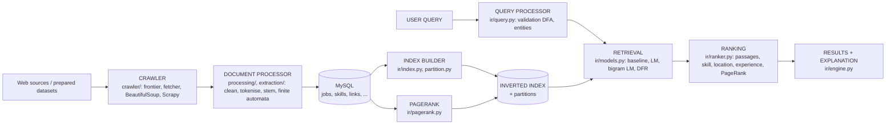

# Search-engine architecture (IR module 15)

| box | responsibility | code | phase |
|---|---|---|---|
| Crawler | URL frontier, polite fetcher (robots.txt), parsers, duplicate filter, link graph | `jobintel/crawler/` | 1 |
| Document processor | HTML removal, mojibake repair, tokenising, stop-words, stemming, extraction of skills/experience/salary/..., duplicate flags | `jobintel/processing/`, `jobintel/extraction/`, `jobintel/ingest/` | 1 |
| Storage | 21 MySQL tables, original + processed text | `jobintel/db/` | 1 |
| Index | vocabulary, postings, df/cf, doc lengths, token sequences, metadata; partitions | `jobintel/ir/index.py`, `partition.py` | 2-3 |
| Query processor | validation, entity recognition, query representation, filters | `jobintel/ir/query.py`, `engine._allowed` | 2 |
| Retrieval | candidate generation + scoring (5 models), also on partitions | `jobintel/ir/models.py`, `distributed.py` | 2-3 |
| Ranking | passage score, skill/location/experience/PageRank signals, configurable hybrid | `jobintel/ir/ranker.py`, `passages.py`, `pagerank.py` | 2 |
| Result presentation | explained results with highlighted passage | `jobintel/ir/engine.py` (JSON), CLI now, web pages in Phase 7 | 2 / 7 |

Separation rule kept in the code: crawling and ingestion never import retrieval code; retrieval reads only the index (+ the display text of a few shortlisted jobs from the database); the web layer will call `SearchEngine.search()` and nothing else.
