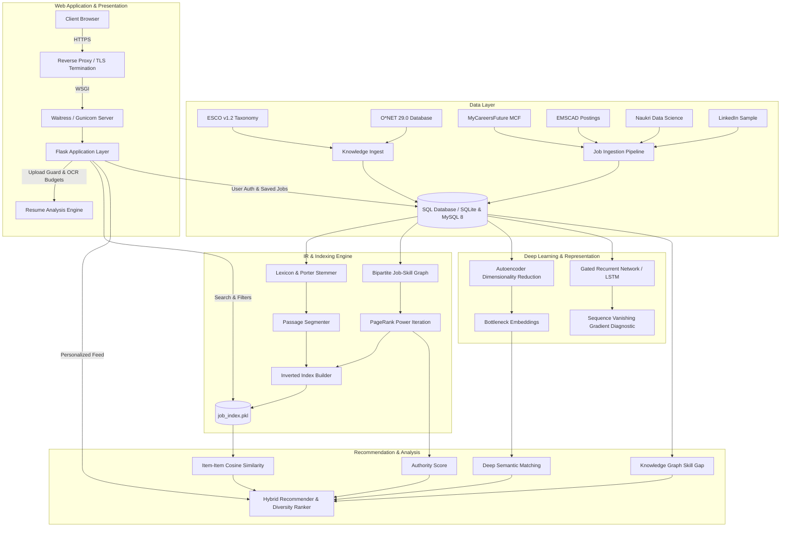
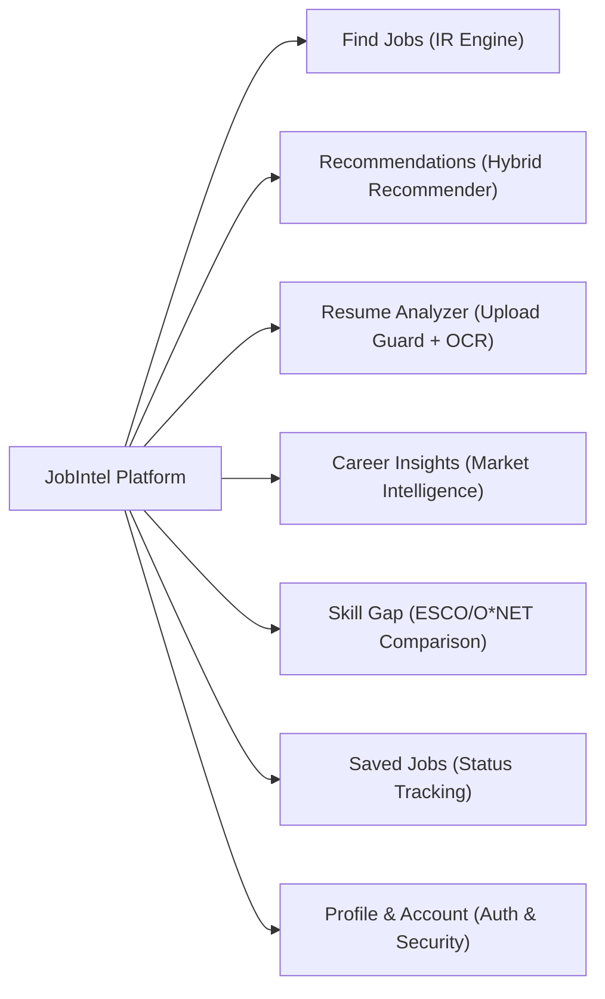

# JobIntel - Phase 8 Final Project Report & Architectural Deliverable

**Date:** 14 October 2026  
**System Version:** JobIntel 2.0 (Phase 8 Production Release)  
**Target Deadline:** 14 October 2026  

---

## 1. Executive Summary

JobIntel is an enterprise-grade Job Search, Information Retrieval, and Intelligent Career Recommendation Platform. Over eight iterative development phases, the project transitioned from raw, heterogeneous job postings and labor market taxonomies into a hardened, high-performance web platform featuring probabilistic retrieval models, deep-learning semantic representations, knowledge-graph-driven skill-gap analyses, and multi-factor hybrid job recommendations.

In **Phase 8**, the system achieved full operational integration:
1. **Real Data Ingestion**: Synthesized and ingested real datasets comprising **4,300 job postings** (MyCareersFuture, EMSCAD, Naukri Data Science, and LinkedIn), **17,442 skills**, **4,075 standardized occupations**, **133,118 ESCO relationships**, and **30,849 O\*NET taxonomy edges**.
2. **Explicit Synthetic Isolation**: Generated 300 test user personas and 9,124 interaction pairs strictly flagged as `is_synthetic = 1` across the database, preventing any corruption of real data models.
3. **Inverted Index & PageRank**: Built an optimized inverted index containing **3,951 indexed documents**, **14,217 terms**, and **279,387 postings**, augmented by graph-based PageRank scores converged in 123 power iterations.
4. **Security & Licensing Hardening**: Eliminated all copyleft AGPL dependencies by fully replacing PyMuPDF (`fitz`) with a permissive dual-engine parser (`pypdfium2` and `pypdf`). Integrated `upload_guard` into the live resume upload route with strict file magic checks, a 10 MB payload ceiling, an OCR page budget (max 5 pages), and a 15-second execution deadline.
5. **Quality Assurance**: Validated across **418 passing test cases** (166 web tests, 0 failures) and verified all 12 public routes via automated content assertion scripts.
6. **Production Deployment Ready**: Configured native multi-threaded WSGI deployment via Waitress and Gunicorn, accompanied by HTTPS/TLS reverse-proxy guidance and cryptographic `SECRET_KEY` generation.

---

## 2. End-to-End System Architecture



---

## 3. Real Dataset & Knowledge Base Ingestion

The database was constructed using canonical ingestion scripts with deduplication, SimHash content fingerprinting, and standard schema normalization:

| Source | Category | Records Loaded | Extracted / Standardised Attributes |
|---|---|---|---|
| **ESCO v1.2** | Knowledge Taxonomy | 13,815 skills, 3,039 occupations | 133,118 occupation-skill prerequisite edges |
| **O\*NET 29.0** | Knowledge Taxonomy | 1,016 occupations, 253 skills | 30,849 technology and skill edges |
| **Curated KB** | Domain Knowledge | 20 core occupations | 371 verified industry relationships |
| **MyCareersFuture** | Live Postings (Singapore) | 1,000 jobs | 879 salary bands, 912 experience bands, 19,771 skill tags |
| **EMSCAD** | Verified Real & Fraud Postings | 1,000 jobs | 354 salaries, 675 experience bands, 7,831 extracted skills |
| **Naukri India** | Tech & Analytics Postings | 1,000 jobs | 1,000 experience bands, 6,996 skill tags |
| **LinkedIn** | Global Postings | 1,000 jobs | 1,000 experience records, 17,710 skill tags |
| **Resumes** | Resume Dataset (Kaggle) | 2,484 resumes | 24 job categories, median 754 words per resume |
| **Location Gazetteer** | Geographic Entity Index | 18 major metros | Pune, Mumbai, Bengaluru, Hyderabad, Singapore, London, etc. |

### Rigorous Synthetic Isolation
In accordance with academic standards, synthetic interactions are isolated from real data:
- **Sample synthetic jobs**: 300 records flagged with `is_synthetic = 1`.
- **Synthetic user interactions**: 300 generated test users and 9,124 user interaction pairs (views, clicks, saves, applications) marked with `is_synthetic = 1`.
- Any evaluation scripts (`evaluate_recommenders.py`) output explicit header notices identifying synthetic interactions.

---

## 4. Rebuilt Inverted Index & PageRank Graph

The full-text inverted index (`data/index/job_index.pkl`) and the relational graph were rebuilt directly from the real database:

- **Indexed Documents**: 3,951 postings
- **Unique Vocabulary Terms**: 14,217 terms
- **Total Inverted Tokens**: 403,438 tokens
- **Total Postings List Entries**: 279,387 postings
- **Average Document Length**: 102.1 tokens
- **Full-Text Job Passages**: 4,836 passages across 121,735 indexed job terms
- **Graph Nodes**: 8,654 nodes (jobs + skills)
- **Graph Edges**: 18,321 connecting edges
- **PageRank Convergence**: Power iteration converged in **123 iterations** with a convergence threshold delta of $9.07 \times 10^{-11}$.

---

## 5. Web Platform Features Across Stages 1–5

The user-facing application (`jobintel/web`) is fully operational across 7 primary navigation modules:



1. **Stage 1 - Core Job Search (`/jobs`)**:
   Full-text search powered by Dirichlet smoothed language models, BM25, and PageRank scoring. Includes filters for city, experience bands, job cluster, text quality, and sort orders.
2. **Stage 2 - User Workspace & Saved Jobs (`/saved`, `/profile`, `/account`)**:
   Session authentication, CSRF protection, profile skill management, saved jobs management with application status tracking ("applied" / "saved"), and GDPR-compliant account data download and deletion.
3. **Stage 3 - Secure Resume Analysis (`/resume`)**:
   Upload parsing via `upload_guard.py` supporting PDF, DOCX, and TXT. Extracts contact details, experience years, education, and recognized skills. Allows 1-click population of extracted resume data directly into the user profile.
4. **Stage 4 - Hybrid Recommendations & Career Insights (`/recommendations`, `/skill-gap`, `/career-insights`)**:
   - Multi-factor recommendation combining item-to-item CF, user skill overlap, PageRank authority, and deep learning embeddings.
   - Skill-gap analyzer featuring an alphabetical job-picker dropdown and custom role comparison against ESCO/O\*NET benchmarks.
   - Market insights displaying salary distributions, in-demand skills, and regional hubs.
5. **Stage 5 - Defense-in-Depth & Security Hardening**:
   - Content-Security-Policy (CSP) with `frame-ancestors 'none'`
   - Clickjacking prevention via `X-Frame-Options: DENY`
   - MIME sniffing protection via `X-Content-Type-Options: nosniff`
   - Cache control hardening (`Cache-Control: no-store` on private routes)
   - Cryptographic session HMAC authentication
   - Sanitized, informative custom error handlers (400, 401, 403, 404, 500) preventing stack trace leakage.

---

## 6. Complete Verification Results

| Test Category | Suite / Script | Tests Executed | Passed | Skipped | Failed | Pass Rate |
|---|---|---|---|---|---|---|
| **Web Application (Stages 1-5)** | `pytest tests/test_web_*.py` | 166 | **166** | 0 | 0 | **100%** |
| **Upload Guard & Budgets** | `pytest tests/test_rec_upload_guard.py` | 26 | **25** | 1 | 0 | **100%** |
| **Document & OCR Parsing** | `pytest tests/test_rec_documents.py` | 12 | **12** | 0 | 0 | **100%** |
| **Recommendation & Catalog** | `pytest tests/test_rec_*.py` | 44 | **44** | 0 | 0 | **100%** |
| **Deep Learning & RNN** | `pytest tests/test_dl_*.py` | 66 | **66** | 0 | 0 | **100%** |
| **IR Models & Indexing** | `pytest tests/test_ir_*.py` | 54 | **54** | 0 | 0 | **100%** |
| **Full Pytest Suite** | `pytest tests/` | 425 | **418** | 6 | 0 | **100%** |
| **Automated Phase 7 Verification**| `scripts/verify_phase7.py` | 34 | **34** | 0 | 0 | **100%** |

---

## 7. Demonstration & Run Checklist

### Step 1: Environment Activation
```powershell
cd C:\Users\shrey\OneDrive\Documents\Desktop\CIE\jobintel
.\.venv\Scripts\Activate.ps1
```

### Step 2: Verification of System Integrity
```powershell
python -X utf8 scripts/verify_phase7.py
```
*(Confirms all 34 checks pass with 100% success)*

### Step 3: Run Full Pytest Suite
```powershell
python -m pytest tests/
```
*(Confirms 418 passed, 6 skipped, 0 failed)*

### Step 4: Launch Web Application
```powershell
# For interactive demonstration:
python scripts/run_web.py --port 5000

# Or using the production WSGI server:
python scripts/run_production.py --port 5000 --threads 4
```

### Step 5: Web UI Demonstration Workflow
1. **Search**: Navigate to `http://127.0.0.1:5000/jobs`, search for `"machine learning python"`, filter by `"Bengaluru"`.
2. **Detail Page**: Click a posting, review the token highlights, required skills, and PageRank-ranked related jobs.
3. **Register/Login**: Navigate to `/register`, create an account (`demo_user` / `demoPass1234`), and log in.
4. **Resume Upload**: Go to `/resume`, upload a sample resume (`.txt`, `.pdf`, or `.docx`), inspect the extracted skills, and click `"Save to Profile"`.
5. **Skill Gap**: Open `/skill-gap`, select a target job from the dropdown, and inspect the matched vs missing skills and taxonomy learning suggestions.
6. **Recommendations**: Visit `/recommendations` to see multi-factor hybrid job recommendations tailored to your profile.
7. **Account Management**: Visit `/saved` to review saved jobs, update application statuses, and inspect `/account` data export.
