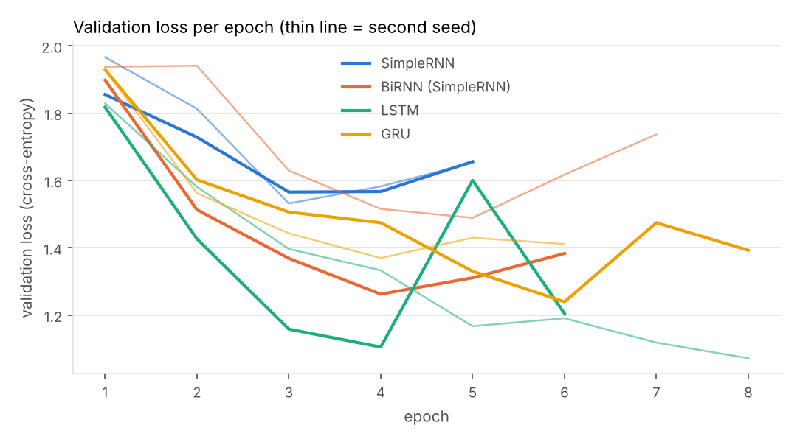
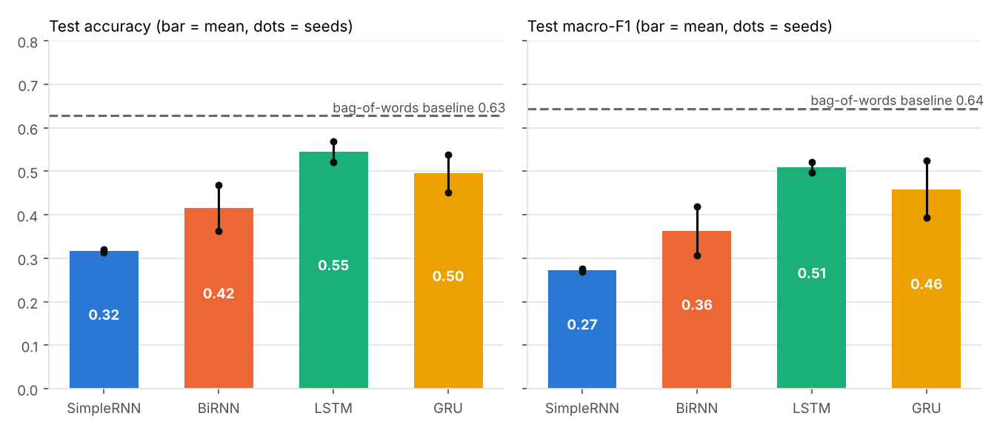
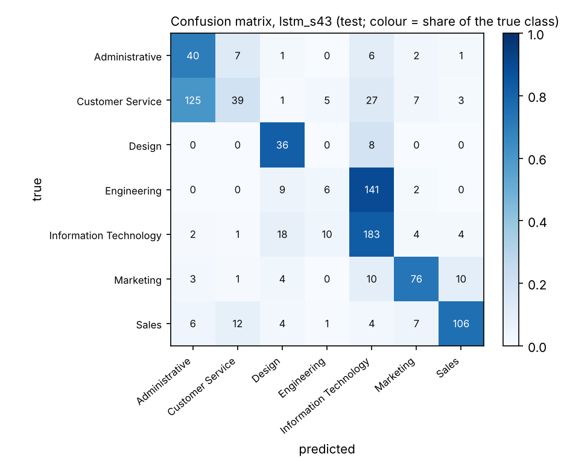
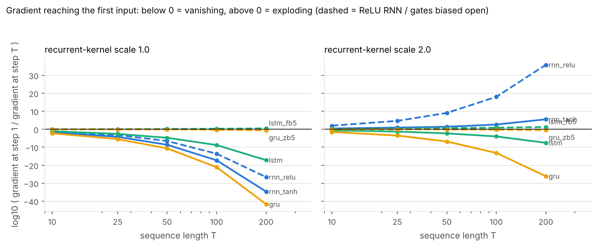
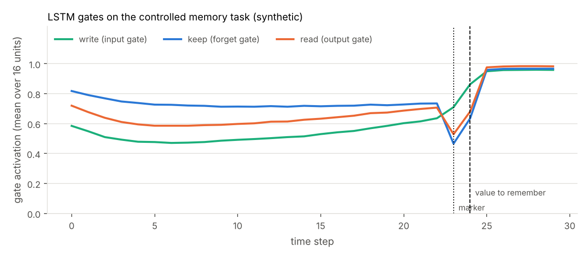
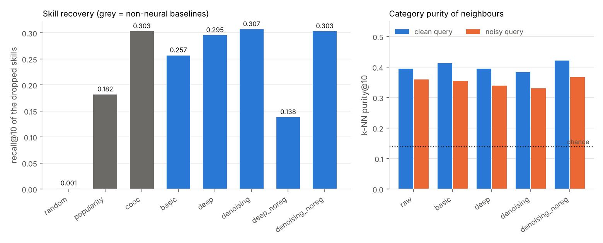

# Phase 5 - Deep learning: results report

*Generated by `scripts/report_dl.py` from `data/dl/results/*.json` and `data/dl/experiments/*.json`. Nothing in this file is typed by hand.*

## 1. Task and data

**Task** - predict a job's *function* from the text of its description with RNN, BiRNN, LSTM and GRU (syllabus: compare the four on a real task).

* labels: the `function` field of the EMSCAD dataset; classes: Administrative, Customer Service, Design, Engineering, Information Technology, Marketing, Sales (class 'Other' and classes with fewer than 250 jobs dropped);
* 10,335 labelled non-fraudulent jobs -> 1,568 near-duplicate descriptions removed (SimHash) -> **5,802 jobs**;
* the job **title is not part of the input** (it would be a shortcut to the label);
* split **by employer**: train 4,060 / validation 810 / test 932; employers appearing in more than one split: 0;
* class sizes: Administrative 419, Customer Service 692, Design 310, Engineering 1109, Information Technology 1556, Marketing 730, Sales 986.

Every model has the same skeleton `Embedding(64, masked) -> recurrent layer (64 units) -> Dropout(0.3) -> Dense(softmax)`, Adam (lr 1e-3, `clipnorm` 1.0), balanced class weights, early stopping on validation loss (patience 2, best weights restored), so the comparison isolates the recurrent cell.

## 2. The four sequence models (test set)

Values are the mean over seeds with (min–max). Validation loss was used for early stopping and for choosing the deployed model; the test set was used once per run for the numbers below.

| model | parameters | seeds | accuracy | macro-precision | macro-recall | macro-F1 | validation loss | train s | epochs |
|---|---|---|---|---|---|---|---|---|---|
| SimpleRNN | 833,863 | 2 | 0.318 (0.314–0.321) | 0.291 (0.285–0.298) | 0.290 (0.280–0.300) | 0.273 (0.269–0.276) | 1.549 (1.532–1.566) | 54 (53–54) | 5 (5–5) |
| BiRNN (SimpleRNN) | 842,567 | 2 | 0.416 (0.364–0.468) | 0.385 (0.328–0.442) | 0.373 (0.320–0.425) | 0.363 (0.307–0.420) | 1.376 (1.263–1.489) | 105 (104–107) | 6 (6–7) |
| LSTM | 858,631 | 2 | 0.545 (0.521–0.569) | 0.527 (0.518–0.537) | 0.568 (0.556–0.580) | 0.509 (0.497–0.520) | 1.089 (1.072–1.105) | 128 (94–162) | 7 (6–8) |
| GRU | 850,567 | 2 | 0.495 (0.452–0.539) | 0.477 (0.424–0.530) | 0.486 (0.440–0.533) | 0.459 (0.394–0.524) | 1.305 (1.240–1.370) | 95 (94–95) | 7 (6–8) |
| Bag-of-words logistic regression (non-neural reference) | 87,080 | 1 | 0.628 | 0.662 | 0.666 | 0.645 | 0.754 | 3 | - |

Per run:

| run | test accuracy | test macro-F1 | val loss | val accuracy | train s | epochs | inference ms/job |
|---|---|---|---|---|---|---|---|
| rnn_s42 | 0.321 | 0.269 | 1.566 | 0.335 | 53 | 5 | 0.74 |
| rnn_s43 | 0.314 | 0.276 | 1.532 | 0.327 | 54 | 5 | 0.73 |
| birnn_s42 | 0.468 | 0.420 | 1.263 | 0.488 | 104 | 6 | 1.41 |
| birnn_s43 | 0.364 | 0.307 | 1.489 | 0.381 | 107 | 7 | 0.80 |
| lstm_s42 | 0.569 | 0.520 | 1.105 | 0.562 | 162 | 6 | 1.41 |
| lstm_s43 | 0.521 | 0.497 | 1.072 | 0.602 | 94 | 8 | 0.68 |
| gru_s42 | 0.539 | 0.524 | 1.240 | 0.489 | 94 | 8 | 0.71 |
| gru_s43 | 0.452 | 0.394 | 1.370 | 0.375 | 95 | 6 | 1.40 |

### Reading the result (computed from the tables)

* Ranking by mean test accuracy: LSTM (0.545) > GRU (0.495) > BiRNN (SimpleRNN) (0.416) > SimpleRNN (0.318).
* The best recurrent model (LSTM, mean accuracy 0.545, macro-F1 0.509) is **below** the bag-of-words logistic-regression reference (accuracy 0.628, macro-F1 0.645). This is reported as measured: on 4,060 training descriptions a linear model on word presence is a strong baseline and the recurrent models, which must learn word meaning from scratch and see only the first 256 tokens, do not beat it.
* LSTM accuracy range 0.521–0.569, GRU 0.452–0.539: the ranges **overlap**, so with two seeds the data do not separate LSTM from GRU.
* The plain SimpleRNN is the weakest (0.318); its training accuracy reached 0.89 while validation accuracy stayed at 0.35 - it memorises the training texts (see section 3 for why long sequences are hard for it).
* Seed-to-seed variation is large (up to 0.104 in accuracy within one model), so differences smaller than that should not be interpreted.





### Deployed model: lstm_s43 (lowest validation loss of all runs)

| class | precision | recall | F1 | test jobs |
|---|---|---|---|---|
| Administrative | 0.227 | 0.702 | 0.343 | 57 |
| Customer Service | 0.650 | 0.188 | 0.292 | 207 |
| Design | 0.493 | 0.818 | 0.615 | 44 |
| Engineering | 0.273 | 0.038 | 0.067 | 158 |
| Information Technology | 0.483 | 0.824 | 0.609 | 222 |
| Marketing | 0.776 | 0.731 | 0.752 | 104 |
| Sales | 0.855 | 0.757 | 0.803 | 140 |




## 3. Vanishing and exploding gradients (measured)

**Method.** One bare recurrent layer (32 units, 16 inputs, float64), random inputs, loss = ½‖h_T‖². With `tf.GradientTape` we take ∂loss/∂x_t for every step t and report log10 of (gradient norm at step 1 / gradient norm at step T): about −k means the first input receives 10^−k of what the last input receives. Median over 5 random initialisations. The recurrent kernel is multiplied by a *scale* (an orthogonal matrix has all singular values 1, so the scale sets the recurrent gain). `rnn_tanh` is Keras' default SimpleRNN, `rnn_relu` the same with ReLU, `lstm`/`gru` use Keras defaults (forget bias 1, update-gate bias 0), `lstm_fb5` has forget-gate bias 5 and `gru_zb5` update-gate bias 5 (the usual remedy that opens the additive path).

**log10(gradient at step 1 / gradient at step T), recurrent scale 1**

| layer (recurrent scale 1) | T=10 | T=25 | T=50 | T=100 | T=200 |
|---|---|---|---|---|---|
| rnn_tanh | -1.7 | -4.2 | -8.6 | -17.2 | -34.7 |
| rnn_relu | -1.2 | -3.2 | -6.5 | -13.6 | -26.6 |
| lstm | -1.1 | -2.6 | -4.7 | -8.8 | -17.2 |
| lstm_fb5 | -0.0 | 0.0 | 0.2 | 0.3 | 0.5 |
| gru | -2.2 | -5.5 | -10.6 | -21.1 | -41.6 |
| gru_zb5 | -0.0 | -0.1 | -0.2 | -0.3 | -0.7 |

**Effect of the recurrent scale (T = 100)**

| layer (T=100) | scale 0.5 | scale 1.0 | scale 1.5 | scale 2.0 |
|---|---|---|---|---|
| rnn_tanh | -44.3 | -17.2 | -4.6 | 2.6 |
| rnn_relu | -44.9 | -13.6 | 5.6 | 18.0 |
| lstm | -11.6 | -8.8 | -6.2 | -4.0 |
| lstm_fb5 | -0.2 | 0.3 | 0.6 | 0.9 |
| gru | -25.5 | -21.1 | -16.8 | -13.2 |
| gru_zb5 | -0.3 | -0.3 | -0.3 | -0.3 |

**Raw magnitudes (scale 1, T = 100)**

| layer (scale 1, T=100) | gradient at last step | gradient at step 1 | ln-gain per step |
|---|---|---|---|
| rnn_tanh | 1.55 | 8.27e-18 | -0.401 |
| rnn_relu | 5.08 | 1.26e-13 | -0.318 |
| lstm | 0.122 | 2e-10 | -0.200 |
| lstm_fb5 | 0.302 | 0.553 | +0.022 |
| gru | 0.458 | 4.51e-22 | -0.481 |
| gru_zb5 | 0.00122 | 0.000589 | -0.007 |



### Reading the result (computed)

* **Vanishing:** with the Keras defaults the SimpleRNN's first input receives 10^-17.2 of the last input's gradient at T = 100; the default LSTM 10^-8.8, the default GRU 10^-21.1.
* **Exploding:** with recurrent scale 2 the ReLU RNN's gradient grows by 10^+18.0 over 100 steps; with tanh the saturation limits growth (+2.6).
* **The cell-state path only helps when it is open:** with forget bias 5 the LSTM keeps the gradient essentially constant (10^+0.5 even at T = 200), whereas the default forget gate (σ(1) ≈ 0.73 per step) still shrinks it. LSTM and GRU therefore *reduce* vanishing by design but do not remove it unless the gates stay near 1.

### Gradient clipping

| layer | median weight-gradient norm (T=100, scale 2) | after clipping to 1 | clipped? |
|---|---|---|---|
| rnn_relu | 6.94e+39 | 1 | yes |
| rnn_tanh | 5e+04 | 1 | yes |
| lstm | 9.98 | 1 | yes |
| gru | 17.8 | 1 | yes |

Clipping rescales the whole gradient so its global norm is at most the threshold: it keeps the *direction* and removes the absurd magnitude, which is why `clipnorm=1.0` is used in every model of this project.

Short training run on the real job data (SimpleRNN, recurrent kernel ×3, 1200 jobs, 3 epochs):

| optimizer | clipnorm | training loss by epoch | non-finite? | train accuracy |
|---|---|---|---|---|
| sgd | None | 2.446, 2.164, 2.037 | no | 0.188 |
| sgd | 1.0 | 2.558, 2.345, 2.172 | no | 0.161 |
| adam | None | 2.594, 2.494, 2.449 | no | 0.142 |
| adam | 1.0 | 2.578, 2.471, 2.435 | no | 0.144 |

In this short run no loss became non-finite with or without clipping (tanh keeps the forward pass bounded and Adam normalises the step size), so the table does **not** show clipping rescuing a diverging run; it is a safeguard, and the weight-gradient norms above show how large the unclipped gradients are.


## 4. LSTM gates and GRU (from-scratch NumPy cells)

`jobintel/dl/numpy_rnn.py` implements SimpleRNN, BiRNN, LSTM (gates i, f, g, o; c_t = f⊙c_{t−1} + i⊙g; h_t = o⊙tanh c_t) and GRU (update z, reset r; h_t = z⊙h_{t−1} + (1−z)⊙n) with the Keras weight layout; `tests/test_dl_numpy_rnn.py` checks equality with the Keras layers (max difference < 1e-5, including masking).

### On a real job description

Source: EMSCAD test split, job_id 27546, label Information Technology; first 40 of 189 tokens traced with the NumPy cell of the *trained* models.

| model | max |NumPy − Keras| on the final state | range of the mean gate value across the traced tokens |
|---|---|---|
| LSTM (lstm_s43) | 1.9e-06 | write_i 0.48–0.54; keep_f 0.70–0.75; read_o 0.48–0.54 |
| GRU (gru_s42) | 1.5e-07 | update_z 0.41–0.56; reset_r 0.50–0.54 |

On real text the **average** gate values barely move (the widest range across the traced tokens is 0.14; they stay near their initial values: forget ≈ σ(1) = 0.73, others ≈ 0.5), so the trained classifiers do not show dramatic selective forgetting. This is plausible: function classification needs a bag of topics, not precise long-range memory. 

To make the gate mechanics visible, a controlled task that *requires* memory is used below (synthetic, for explanation only).

### Controlled memory task (SYNTHETIC; not part of the job workflow)

A sequence of random noise tokens contains a MARKER token; the token right after it is a VALUE (1..8) that must be reported at the end. The model must write the value when the marker has just been seen, keep it through the noise, and read it at the end.

| setting | test accuracy (mean (min–max) over seeds) | seeds |  |
|---|---|---|---|
| short_gap (T=30, marker anywhere) | rnn 0.957 (0.872–1.000), lstm 1.000 (1.000–1.000), gru 1.000 (1.000–1.000) | 3 | chance 0.125 |
| long_gap (T=80, marker in the first 10 steps) | rnn 0.126, lstm 0.125, gru 0.131 | 1 | chance 0.125 |
| medium_gap (T=50, marker in the first 10 steps) | rnn 0.984 (0.951–1.000), lstm 1.000 (1.000–1.000), gru 0.132 (0.123–0.141) | 3 | chance 0.125 |

* short_gap (T=30, marker anywhere): every model reached ≥ 0.96 mean accuracy, so this setting does not separate them.
* long_gap (T=80, marker in the first 10 steps): no model reached ≥ 0.9 accuracy; rnn, lstm, gru stayed near chance (rnn 0.13, lstm 0.13, gru 0.13).
* medium_gap (T=50, marker in the first 10 steps): rnn, lstm reached ≥ 0.9 accuracy; gru stayed near chance (gru 0.13). This is consistent with section 3: at T = 50 the gradient reaching the first input is 10^-10.6 of the last step's for a default GRU (update-gate bias 0) against 10^-4.7 for a default LSTM (forget bias 1). It is a training failure of this setting (fixed learning rate and epochs), not proof that GRUs cannot remember.

* short_gap (T=30, marker anywhere), LSTM seed 0 (accuracy 1.00): write gate 0.80 at the value step vs 0.63 on noise; forget gate 0.87 on the noise after the value; cell-state change 0.70 at the value vs 0.15 on noise; on average 5.4 of 16 units raise their write gate by more than 0.3 at the value step.
* short_gap (T=30, marker anywhere), LSTM seed 1 (accuracy 1.00): write gate 0.70 at the value step vs 0.70 on noise; forget gate 0.80 on the noise after the value; cell-state change 0.83 at the value vs 0.17 on noise; on average 2.5 of 16 units raise their write gate by more than 0.3 at the value step.
* short_gap (T=30, marker anywhere), LSTM seed 2 (accuracy 1.00): write gate 0.76 at the value step vs 0.59 on noise; forget gate 0.80 on the noise after the value; cell-state change 0.70 at the value vs 0.13 on noise; on average 6.0 of 16 units raise their write gate by more than 0.3 at the value step.
* medium_gap (T=50, marker in the first 10 steps), LSTM seed 0 (accuracy 1.00): write gate 0.57 at the value step vs 0.60 on noise; forget gate 0.77 on the noise after the value; cell-state change 0.48 at the value vs 0.30 on noise; on average 3.5 of 16 units raise their write gate by more than 0.3 at the value step.
* medium_gap (T=50, marker in the first 10 steps), LSTM seed 1 (accuracy 1.00): write gate 0.51 at the value step vs 0.65 on noise; forget gate 0.84 on the noise after the value; cell-state change 0.33 at the value vs 0.32 on noise; on average 0.2 of 16 units raise their write gate by more than 0.3 at the value step.
* medium_gap (T=50, marker in the first 10 steps), LSTM seed 2 (accuracy 1.00): write gate 0.48 at the value step vs 0.62 on noise; forget gate 0.79 on the noise after the value; cell-state change 0.30 at the value vs 0.34 on noise; on average 0.9 of 16 units raise their write gate by more than 0.3 at the value step.

**Summary:** in 2 of 6 LSTM runs that solved the task, the average write gate is clearly higher (> 0.1) at the value step than on noise *and* the cell state changes more than 1.5× as much there. Where this does not hold the network still solves the task, so selective writing is a *mechanism the cell can use*, visible in some runs and more clearly in some units than in the unit average - not something every trained LSTM shows in its mean gate values.




## 5. Autoencoders on skill vectors

**Data.** Multi-hot vectors over the 1,500 most frequent non-ambiguous skills (vocabulary chosen on the training split only) for 36,434 real jobs (EMSCAD, LinkedIn and Naukri; no synthetic rows, fraud or duplicates; at least 3 vocabulary skills), split **by employer**: train 25,318, test 7,844, val 3,272. Latent size 64. **Corruption** (training and test): each present skill is dropped with probability 0.3 (at least one dropped, one kept) and 0–3 random absent skills are added.

**Models.** *basic* (F→64→F), *deep* (F→512→256→64→256→512→F), *denoising* (the deep architecture trained on corrupted input to reconstruct the clean vector; the main model), plus *_noreg* variants without L2 (1e-5) and dropout (0.2) as the regularisation ablation. Sigmoid outputs, binary cross-entropy, Adam, early stopping on validation loss.

### Recovering the dropped skills (test split, same corrupted input for every method)

| method | recall@5 | recall@10 | recall@20 | hit@10 | recall@10 minus co-occurrence [95% interval] | spurious-skill AUC |
|---|---|---|---|---|---|---|
| random (baseline) | 0.001 | 0.001 | 0.002 | 0.001 | - | - |
| popularity (baseline) | 0.118 | 0.182 | 0.257 | 0.365 | - | 0.831 |
| cooc (baseline) | 0.212 | 0.303 | 0.407 | 0.528 | - | 0.907 |
| basic | 0.178 | 0.257 | 0.352 | 0.465 | -0.0462 [-0.0578, -0.0344] | 0.905 |
| deep | 0.214 | 0.295 | 0.397 | 0.516 | -0.0075 [-0.0147, +0.0003] | 0.922 |
| denoising | 0.218 | 0.307 | 0.415 | 0.532 | +0.0040 [-0.0024, +0.0106] | 0.922 |
| deep_noreg | 0.092 | 0.138 | 0.201 | 0.288 | -0.1651 [-0.1746, -0.1555] | 0.884 |
| denoising_noreg | 0.213 | 0.303 | 0.405 | 0.523 | +0.0000 [-0.0086, +0.0089] | 0.911 |

7,844 test jobs. Candidates exclude every skill already present in the noisy input (including the random ones). *Random* ranks skills at random, *popularity* by training frequency, *cooc* by Σ P(skill | present skill) from training co-occurrence. *Spurious-skill AUC*: among skills present in the noisy input, how well the score separates true skills from the randomly added ones (1 = perfect, 0.5 = chance). The interval is an employer-clustered bootstrap of the paired difference to the co-occurrence baseline (descriptive, not a hypothesis test).

### Reading the result (computed)

* The denoising autoencoder recovers 0.307 of the dropped skills in its top 10 versus 0.182 for popularity and 0.303 for co-occurrence. The paired difference to co-occurrence is +0.0040 with interval [-0.0024, +0.0106]: the interval contains 0, so **the autoencoder is not better than the simple co-occurrence baseline** on this task; it matches it with one compact model (a 64-dimensional code) and additionally gives a latent representation.
* **Regularisation matters for the clean-input deep autoencoder:** without L2/dropout its recall@10 is 0.138 versus 0.295 with them (BCE on a training subset 0.01989 vs test 0.02402; it fits the training jobs better than unseen ones).
* Trained on corrupted input the un-regularised model reaches recall@10 0.303 versus 0.307 regularised - nearly the same, so the corruption itself acts as a regulariser (the classical argument for denoising autoencoders).
* Cosine similarity to the clean vector: the noisy input has 0.712; the reconstruction as a top-m set has 0.293 (denoising model). The reconstruction is a *typical profile* for the observed skills, not a copy of them, so this raw cosine is lower than the input's - it is reported because the syllabus asks for it, but recovery@k and spurious-skill AUC are the meaningful measures here.

### Do the latent codes keep the job category? (k-NN, k = 10)

Labels: EMSCAD job-function categories (Accounting/Auditing, Administrative, Business Development, Customer Service, Design, Engineering, Health Care Provider, Information Technology, Management, Marketing, Project Management, Sales); queries are test jobs, neighbours are training jobs (1,385 queries, 4,997 reference jobs). The MyCareersFuture categories originally planned could not be used in this session (the file could not be downloaded), so the EMSCAD labels are used.

| representation | purity@10 (clean query) | purity@10 (noisy query) | k-NN accuracy (clean) |
|---|---|---|---|
| raw | 0.394 | 0.360 | 0.492 |
| basic | 0.412 | 0.354 | 0.495 |
| deep | 0.395 | 0.340 | 0.480 |
| denoising | 0.383 | 0.330 | 0.441 |
| deep_noreg | 0.369 | 0.307 | 0.484 |
| denoising_noreg | 0.421 | 0.367 | 0.536 |

Chance purity is 0.139. The 64-dimensional codes keep about as much category information as the 1,500-dimensional raw vectors (best latent: denoising_noreg, 0.421 vs raw 0.394). With noisy queries purity drops by 0.035 for the raw vectors and 0.053 for the denoising codes: the denoising codes are **not** more robust to the corruption here.

### Model details

| model | architecture | regularised | trained on corrupted input | parameters | epochs | test BCE clean→clean | test BCE noisy→clean | BCE noisy→clean on train subset | cosine(top-m recon, clean) / (probabilities, clean) | train s |
|---|---|---|---|---|---|---|---|---|---|---|
| basic | basic | yes | no | 193,564 | 40 | 0.01539 | 0.01953 | 0.01944 | 0.467 / 0.546 | 62 |
| deep | deep | yes | no | 1,834,012 | 40 | 0.01969 | 0.02157 | 0.02182 | 0.311 / 0.381 | 216 |
| denoising | denoising | yes | yes | 1,834,012 | 40 | 0.02077 | 0.02171 | 0.02221 | 0.293 / 0.364 | 270 |
| deep_noreg | deep | no | no | 1,834,012 | 27 | 0.01319 | 0.02402 | 0.01989 | 0.469 / 0.538 | 147 |
| denoising_noreg | denoising | no | yes | 1,834,012 | 40 | 0.01242 | 0.01653 | 0.01240 | 0.543 / 0.618 | 221 |



Recall@10 by data source (test):

| source | denoising | popularity | co-occurrence |
|---|---|---|---|
| emscad | 0.245 | 0.149 | 0.246 |
| linkedin | 0.315 | 0.162 | 0.318 |
| naukri | 0.361 | 0.235 | 0.345 |

EMSCAD skills are *extracted* from the description text; LinkedIn and Naukri skills are the postings' own tags, so the sources differ in how predictable the skills are.


## 6. Case studies (separate from the job workflow)

### Image compression: convolutional autoencoder vs PCA

Data: sklearn load_digits (1797 real 8x8 grey images; test = 25%). A 64-pixel image is stored as k numbers.

| code size k | compression | conv-AE test MSE | PSNR dB | PCA test MSE | PSNR dB |
|---|---|---|---|---|---|
| 4 | x16 | 0.0254 | 15.9 | 0.0382 | 14.2 |
| 8 | x8 | 0.0155 | 18.1 | 0.0246 | 16.1 |
| 16 | x4 | 0.0090 | 20.5 | 0.0115 | 19.4 |

The convolutional autoencoder has the lower error at 3 of 3 code sizes. The images are tiny (8×8), so this is a demonstration of the technique, not of image-codec performance.

### Variational autoencoder

Latent 8, loss = reconstruction + β·KL (β = 1.0). Test MSE from the mean code 0.0284; KL 3.17 nats per image. 500 images sampled from N(0, I) were classified by a logistic-regression digit classifier trained on real digits (test accuracy 0.969): mean top-class probability 0.64, 10 of 10 digits produced (histogram [54, 33, 43, 51, 59, 53, 52, 48, 47, 60]). Compared with the deterministic convolutional autoencoder, the VAE trades reconstruction sharpness for a latent space that can be sampled; both are small-scale demonstrations.

### Network-traffic anomaly detection — SYNTHETIC DATA

**Data: SYNTHETIC flows (generator with CIC-IDS2017-like features).** The CIC-IDS2017 files were not available, so flows are generated (normal: web, DNS, SSH, streaming; attacks: DoS, port scan, brute force, exfiltration). The numbers describe this generator, **not** real intrusion-detection performance. `load_cic_ids` reads the real CSVs if you supply them.

Autoencoder trained on 12,000 normal flows only; threshold = 99% quantile of validation-normal reconstruction error (no attack used to choose it). Test: 6,000 flows, 2,000 attacks.

* at the threshold: precision 0.969, recall 0.790, F1 0.871, false-positive rate 0.013; threshold-free AUC 0.966;
* baselines fitted on the same normal data: PCA reconstruction error AUC 0.983, Isolation Forest AUC 0.945 - **PCA is at least as good as the autoencoder on this generator** (its feature relations are close to linear).

| attack | n | recall at threshold | AUC autoencoder | AUC PCA | AUC isolation forest |
|---|---|---|---|---|---|
| bruteforce | 500 | 0.16 | 0.867 | 0.938 | 0.889 |
| dos | 500 | 1.00 | 1.000 | 1.000 | 1.000 |
| exfiltration | 500 | 1.00 | 0.999 | 0.996 | 0.969 |
| portscan | 500 | 1.00 | 0.999 | 0.996 | 0.920 |

Brute-force flows were made deliberately similar to normal logins, which is why they are the hardest.

### Brief case-study notes (text only, not application modules)

* **Image captioning** — an encoder (a convolutional network) turns the image into a feature vector that initialises or conditions a recurrent decoder (LSTM/GRU); the decoder emits the caption one word at a time, each step fed by the previous word. It reuses exactly the recurrent machinery of section 2, with the image as the initial context.
* **Facial recognition** — a convolutional network maps a face to an embedding in which images of the same person are close; verification compares two embeddings against a threshold and identification searches the nearest stored embedding. Training uses metric-learning losses (contrastive/triplet). The same embed-then-compare idea is used in this project for job and resume similarity.
* **Self-driving** — perception (convolutional networks for detection and segmentation), prediction (recurrent models over object tracks) and planning/control are combined; safety depends on rare cases, sensor fusion and validation far beyond what a classifier accuracy shows. Not implemented here.


## 7. Deployed encoder and embeddings

`DLEncoder` loads the sequence model with the lowest validation loss (**lstm_s43**) and `scripts/build_dl_embeddings.py` pre-computes a 64-dimensional L2-normalised vector for every job with description text (`data/dl/embeddings_text.npz`) and a denoising-autoencoder latent code for every job with skills (`embeddings_skills.npz`); nothing is computed at search time.

**Sanity check of the text embeddings.** Test-split jobs (never seen by the model, employers not in training) were used as queries against training jobs: the share of the 10 nearest neighbours with the same job function is **0.567** (chance 0.178); a 10-NN majority vote reaches 0.585 accuracy (932 queries, 4,060 reference jobs). So the embedding carries job-function information beyond chance; it is not claimed to be an optimal similarity measure.


## 8. Limitations and honest notes

* **Recurrent models vs. the baseline.** On this task and data size the recurrent models do not beat a bag-of-words logistic regression (section 2). They are the syllabus subject; the project does not claim they are the best classifier.
* **Few seeds.** 2 seeds per model; variation between seeds is large, so small differences are noise. More seeds would be needed for confident rankings.
* **Truncation.** Descriptions are cut at 256 tokens (57% of descriptions are longer), which handicaps all four models equally but the SimpleRNN most.
* **Run-to-run reproducibility.** Seeds fix initialisation and shuffling, but TensorFlow on different machines/thread counts does not give bit-identical training: one LSTM run retrained in a later session gave a different test accuracy than the first time (the other reproduced exactly). The numbers here are from the latest run of each configuration.
* **Label quality.** Function labels were chosen by advertisers; some classes overlap (IT vs Engineering).
* **Autoencoders.** The skill-vector task is evaluated on corruption that we generated; the 30%/0–3 noise rates are assumptions. The denoising model ties the co-occurrence baseline; its value in the platform is a compact code and a single model for suggestion and similarity.
* **Controlled memory task** and **network-traffic data** are synthetic and labelled as such; they illustrate mechanisms and do not measure real-world performance.
* **MyCareersFuture** could not be re-downloaded in the session that produced these results, so category purity uses EMSCAD labels, and the search index used for embeddings was rebuilt without MyCareersFuture.


## 9. Reproduce

```
python scripts/train_dl.py --prepare
python scripts/train_dl.py --model baseline rnn birnn lstm gru --seeds 42 43 --skip-existing    # repeat until nothing is left (resumable)
python scripts/run_gradient_experiment.py
python scripts/trace_gates.py
python scripts/run_gate_demo.py --only short medium --seeds 0 1 2
python scripts/train_autoencoder.py
python scripts/run_case_studies.py
python scripts/build_dl_embeddings.py
python scripts/report_dl.py
```
